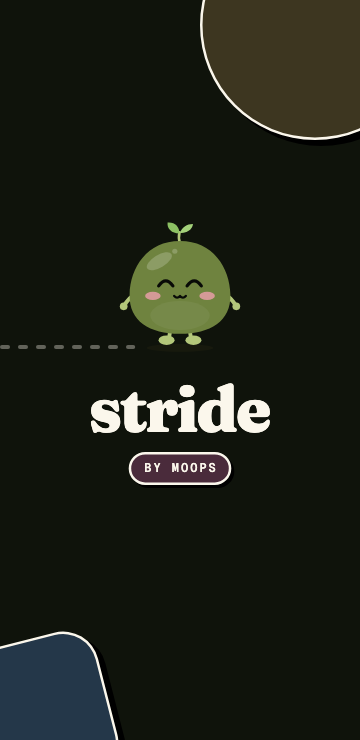
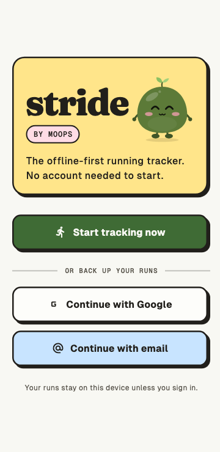
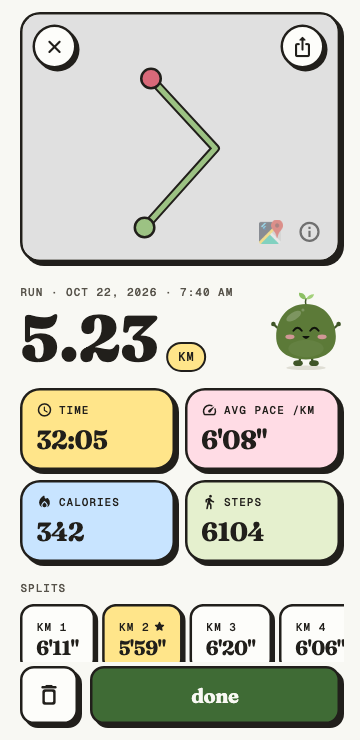
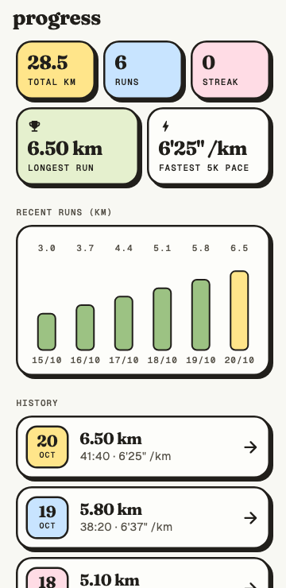
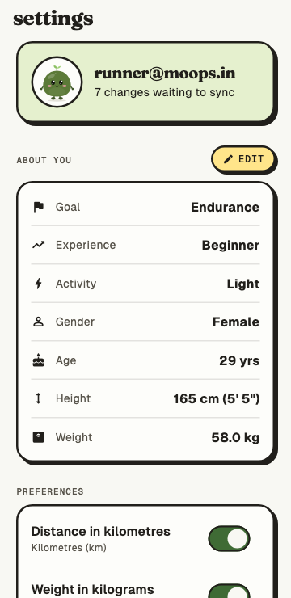
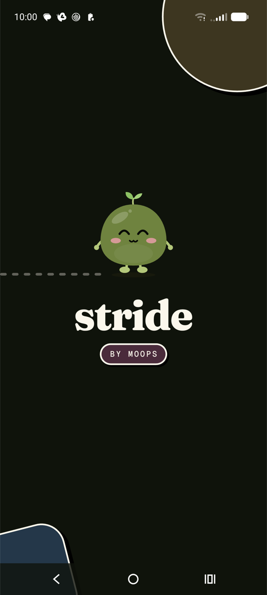
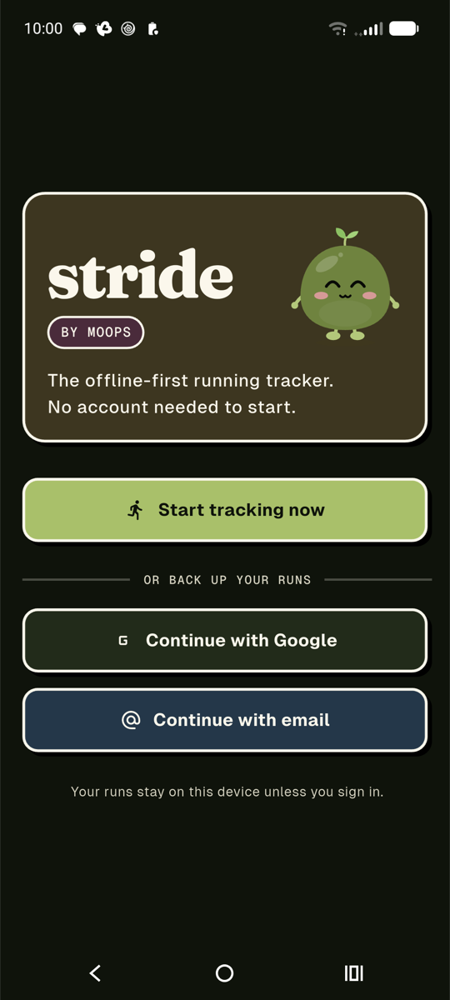
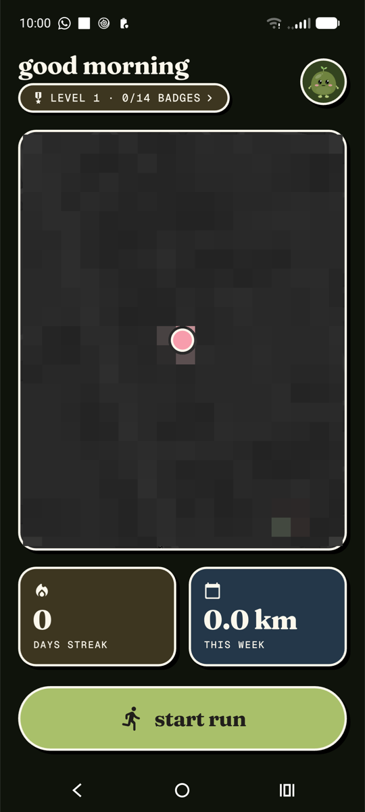

<p align="center">
  
</p>

<h1 align="center">stride</h1>

<p align="center">
  <strong>A cute, offline-first running tracker by <a href="https://moops.in">Moops</a>.</strong><br>
  Your runs live on your phone. Sign in only if you want them backed up.
</p>

<p align="center">
  
  
  
  
  
</p>

<p align="center"><sub>Rendered by the screen tests (light theme)</sub></p>

<p align="center">
  
  
  
</p>

<p align="center"><sub>On a real phone: Motorola edge 70, dark mode (map pixelated for privacy)</sub></p>

---

## What it does

- **Track runs and walks** with live distance, time, pace and steps. GPS runs through a small native foreground service (Kotlin and Swift), so tracking keeps going with the screen locked.
- **Simple, safe controls.** While running there's only a pause button. To finish, pause and then press-and-hold.
- **Run summaries** with the route on a map, pace, calories, steps and per-km (or per-mile) splits. Share the whole card as an image.
- **Progress:** streaks, a weekly total, personal records, a recent-runs chart and full history. Deleting a run can be undone.
- **Works without an account.** Everything is stored locally in SQLite. Signing in (Google or email) adds two-way cloud sync to Firestore, including your profile and unit preference.
- **Moop**, the Moops mascot, runs with you: on the splash screen, in empty states, and celebrating your finished runs.

## Design

Stride uses cute neo-brutalism: flat pastel blocks, 2.5 px ink outlines, hard offset shadows and rounded corners. Each card has one colour, and everything sits on a single spacing grid.

| | |
|---|---|
| Palette | Moops brand colours from [moops.in](https://moops.in): cream, ink, olive green, butter, blush, sky, sage. A matching dark theme is included. |
| Type | **Fraunces** for display, **Geist** for UI, **Geist Mono** for labels and numbers. All three are bundled, so no network is needed. |
| Mascot | Moop is a Flutter `CustomPainter` built from the same geometry as the website's SVG. It has moods (idle, happy, excited, sleepy, shocked), breathes, blinks, and has a running cycle. See `lib/core/widgets/moop.dart`. |
| Tokens | `lib/theme/app_theme.dart` (`StrideColors`, `Brutal`), with components in `lib/theme/brutal_card.dart`. |

## Tech stack

| Area | Choice |
|---|---|
| App | Flutter (Android, iOS), Riverpod 3 |
| Local data | `sqflite`, offline-first; the cloud is optional |
| Cloud | Firebase Auth (Google, email) + Cloud Firestore |
| Location | Custom native bridge (`StrideLocationService` on Android, `CLLocationManager` on iOS) |
| Maps | `flutter_map` with MapTiler tiles |
| Steps | `pedometer` |
| Charts and motion | `fl_chart`, `flutter_animate` |

### How sync works

- **Local first.** Every change is written to SQLite first and marked `synced = 0`.
- **Push.** Changes are uploaded in chunks under Firestore's batch limit. A record the server rejects is retried on its own, so one bad run can't block the others. If the device is offline, the upload times out and is retried later.
- **Pull.** Data is read from the server, never from Firestore's cache, and merged into SQLite:
  - Changes still waiting to upload win over the cloud copy.
  - Runs deleted on another device are removed here too. Deleted runs are kept as deletion markers until every device has seen them.
  - For the profile, the most recently edited copy wins.
- **When it runs.** On app start, when the app returns to the foreground (at most every 10 minutes), at sign-in, and from **Settings → Sync now**.
- **Security rules.** `firestore.rules` lets each user read and write only their own documents.

## Getting started

**Requirements:** Flutter 3.44 or newer (Dart 3.12), plus Xcode or Android Studio for device builds.

1. **Clone and install.**
   ```bash
   git clone https://github.com/moopsIN/MoopsStride.git
   cd MoopsStride
   flutter pub get
   ```
2. **Add your MapTiler key.** Create `lib/core/config/secrets.dart`. It is gitignored.
   ```dart
   class Secrets {
     static const String mapTilerKey = 'YOUR_MAPTILER_KEY';
   }
   ```
3. **Firebase.** The repo includes config for the Moops project. To use your own project, run `flutterfire configure`, enable Google and Email/Password sign-in, create a Firestore database, and deploy the rules:
   ```bash
   firebase deploy --only firestore:rules
   ```
4. **Run it.**
   ```bash
   flutter run
   ```

## Tests

```bash
flutter test
```

- **Unit tests** cover the sync engine (against `fake_cloud_firestore`), the database, splits, pace formatting and progress stats.
- **Screen tests** render every screen in light and dark at a 360 px width, with real fonts. They fail on any layout overflow or framework error.
- **Screenshots.** Set `STRIDE_SHOTS` to save each rendered screen as a PNG while designing:
  ```bash
  STRIDE_SHOTS=/tmp/shots flutter test test/screens
  ```

## Project layout

```
lib/
  core/        database, shared widgets (Moop, buttons, headers), utils
  features/    auth · onboarding · tracking · progress · profile · sync · splash
  theme/       design tokens, ThemeData, brutal components
assets/
  brand/       Moop SVG (used in this README)
  fonts/       Fraunces, Geist, Geist Mono (+ OFL licences)
test/
  helpers/     screen-test harness (stubbed Firebase and plugins)
  screens/     light/dark render tests for every screen
```

## License

Code: [MIT](LICENSE) © 2026 Moops Design. Fonts: SIL Open Font License (see `assets/fonts`). Moop and the Moops name and brand belong to Moops Design.
